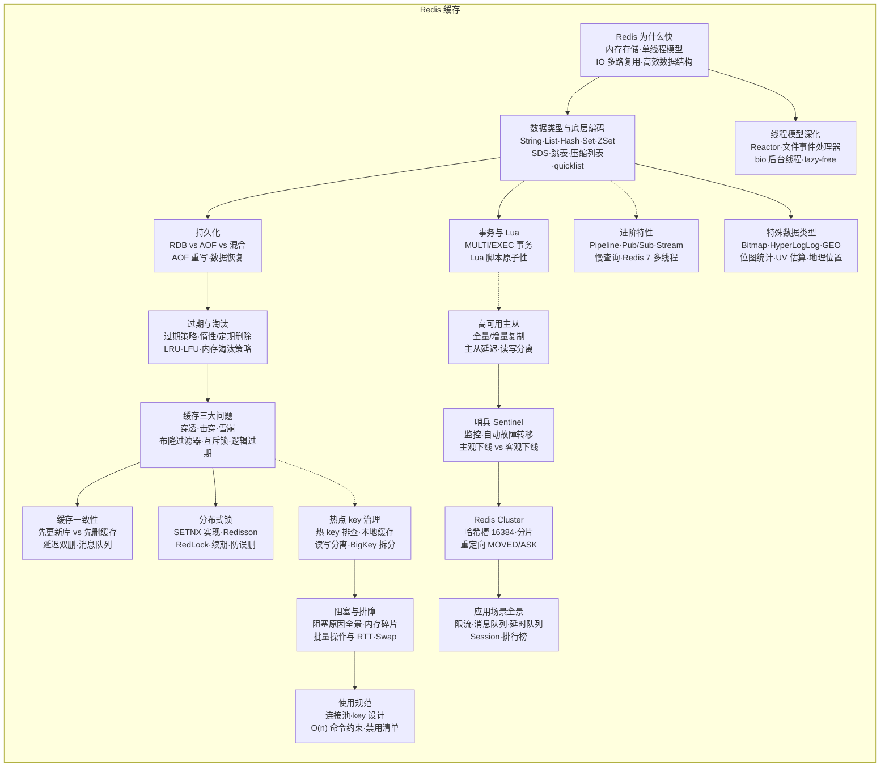

## 节点索引

> diff 基准日期：2026-10-14 ｜ 参照系：小林 coding《图解Redis》+ JavaGuide Redis 上下篇 + Redis 官方文档（三源）

| 节点 | 考点笔记 | 状态 | 参照系覆盖 |
|---|---|---|---|
| R0 为什么快 | Why Quickly.md | ✅ 已钉 | 小林 √ JavaGuide √ |
| R1 数据类型与底层编码 | DataType.md | ✅ 已钉 | 小林 √ JavaGuide √ |
| R2 持久化 | RDB&AOF.md | ✅ 已钉 | 小林 √ JavaGuide √ |
| R3 过期与淘汰 | LRU & LFU.md | ✅ 已钉 | 小林 √ JavaGuide √ |
| R4 缓存三大问题 | Cache Problem.md | ✅ 已钉 | 小林 √ JavaGuide √ |
| R5 缓存一致性 | Cache Consistency.md | ✅ 已钉 | 小林 √ JavaGuide √ |
| R6 分布式锁 | Lock.md | ✅ 已钉 | 小林 √ JavaGuide √ |
| R7 事务与 Lua | Lua.md | ✅ 已钉 | JavaGuide √（小林仅略提） |
| R8 高可用主从 | Master&Slave.md | ✅ 已钉 | 小林 √ JavaGuide √ |
| R9 哨兵 Sentinel | Sentinel.md | ✅ 已钉 | 小林 √ JavaGuide √ |
| R10 Redis Cluster | Redis Cluster.md | ✅ 已钉 | 小林 √ JavaGuide √ |
| R11 热点 key 治理 | Hot Key.md | ✅ 已钉 | 小林 √ JavaGuide √ |
| R12 进阶特性 | New.md | ✅ 已钉 | JavaGuide √ |
| **R13 特殊数据类型** | — | ⬜ 空 | JavaGuide √√ 小林 √（活跃用户/UV 统计为高频应用题） |
| **R14 应用场景全景** | — | ⬜ 空 | JavaGuide 专章 √ 小林应用场景篇 √ |
| **R15 线程模型深化** | — | ⬜ 空 | JavaGuide 专章 √ 官方 threading docs √ |
| **R16 阻塞与排障** | — | ⬜ 空 | JavaGuide 专章 √ 小林大Key持久化篇 √ |
| **R17 使用规范** | — | ⬜ 空 | JavaGuide √ 《Redis 开发与运维》体系 √ |

### 候选扩充（单源或细节级，暂不建节点，挂到对应现有专题）

| 候选内容 | 归属节点 | 来源 |
|---|---|---|
| Redis vs Memcached 选型对比 | R0 | JavaGuide 单源主推 |
| 缓存预热（定时任务/MQ 预热） | R4 | JavaGuide 雪崩节 |
| WATCH 乐观锁 · Redis Functions(7.0) | R7 | JavaGuide 事务节 |
| Pub/Sub vs Stream 为何后者才能做可靠 MQ | R12 | JavaGuide 应用节 |
| Redis 8 Stack（JSON/Search/Vector set） | 暂缓 | 仅官方主线，后端面试弱相关 |

### 已核销的虚报缺口（防重复排查）

| 疑似缺口 | 核查结果 |
|---|---|
| 脑裂 | Sentinel.md + Master&Slave.md 均已覆盖 ✅ |
| 复制积压缓冲区 / 断线续传 | Master&Slave.md 已覆盖（repl_backlog）✅ |
